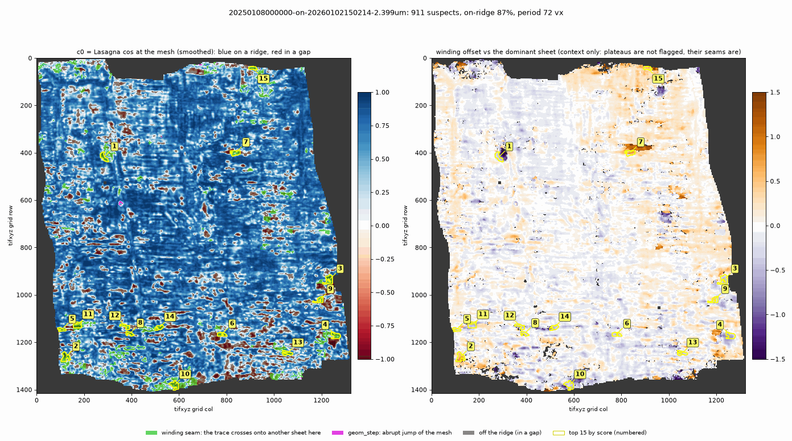
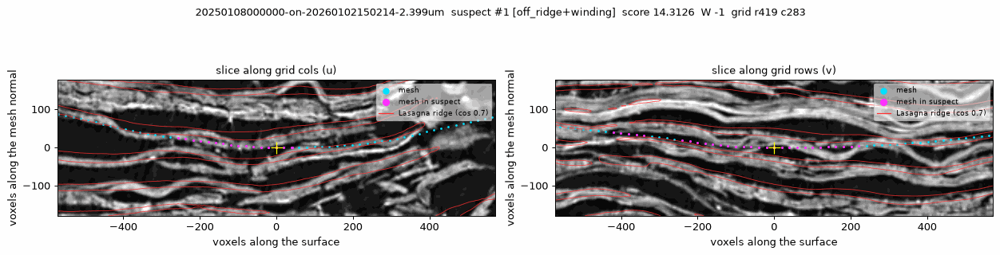

# sheet-ridge-audit

Find the places where a Vesuvius Challenge **tifxyz** segment **leaves its
papyrus sheet** or **switches to a neighbouring sheet**, and rank them for a
human to check.

**Why.** A sheet switch is the costliest tracing error: everything unrolled
beyond it is read from the wrong wrap. Abrupt switches leave a geometric
fingerprint (a step, a stretched edge, a self-intersection) that existing
geometry checkers find well. A **gradual** switch does not: the mesh drifts
smoothly across the gap onto the next sheet and stays smooth, so a
geometry-only checker sees nothing. This tool looks at the volume instead.
It samples the public **Lasagna** sheet prediction (`cos`, from
[ScrollPrize/villa `lasagna`](https://github.com/ScrollPrize/villa)) along the
surface normal at every grid vertex and asks two questions:

* **Is the mesh on a sheet?** `c0` = Lasagna cos at the mesh (+1 on a sheet,
  -1 midway between two sheets). A band with c0 < 0 is an `off_ridge`
  suspect.
* **Did it change sheets?** The phase of the profile says how far, in sheet
  periods, the mesh sits from its nearest ridge. Unwrapped over the grid, it
  steps by one whole period where the trace crosses onto the next sheet. That
  band is a **`winding` seam**.

An abrupt switch (a whole sheet jumped between two neighbouring vertices)
keeps the phase mod one period, so the field cannot see it. Since v0.3 the
tool therefore also has a cheap geometry cue for abrupt jumps,
**`geom_step`**, after the MIT-licensed geometry checkers tifxyz-doctor and
tifxyz-repair. Gradual switches come from the field, abrupt ones from the
geometry.

Output: a ranked suspect list (CSV, JSON, VC3D point collection), overview
maps and CT cross-sections of the top suspects. Raw CT can be used instead of
Lasagna (`--backend ct`) for scans without a prediction, but it is a much
weaker signal.

**Status: v0.3.0 (October 2026), a research tool.** It runs end to end on
real public segments in a few minutes. Its thresholds are calibrated on
planted switches. Its precision on real data has only been measured with a
small, blind **AI-agent** review of 2-D CT slices on one scroll, not with
expert labels; see *Evaluation* before trusting a flag.

## Install

```bash
pip install git+https://github.com/landonking0808/sheet-ridge-audit
sheet-ridge-audit --help
```

Python >= 3.9; pulls numpy, scipy, tifffile, imagecodecs, numcodecs, fsspec,
aiohttp, requests, matplotlib. No GPU, no torch. For development:

```bash
git clone https://github.com/landonking0808/sheet-ridge-audit && cd sheet-ridge-audit
pip install -e '.[test]'    # + pytest, zarr (tests only)
pytest -q                   # offline, 40 tests, about 1-2 min
```

Nothing is downloaded up front. Only the field chunks along the mesh are
streamed, into a memory cache bounded by `--cache-mb`. Nothing large is
written to disk.

## Quickstart on a real public segment

PHerc0139, segment `w025`, traced natively on scan `20260102150214` (2.399 um),
the same scan the Lasagna prediction was made on:

```bash
BASE=https://vesuvius-challenge-open-data.s3.amazonaws.com/PHerc0139
SEG=$BASE/segments/20250108000000-w025_2025010863/mesh/20250108000000-on-20260102150214-2.399um.tifxyz
mkdir -p w025.tifxyz && for f in x.tif y.tif z.tif meta.json; do curl -s -o w025.tifxyz/$f $SEG/$f; done   # 22 MB

sheet-ridge-audit audit w025.tifxyz --scroll PHerc0139 --out out/w025      # stride 1 (default)
```

What to expect (a verification run of v0.3.0 from a fresh `pip install`, on
a shared 2-vCPU host at load average about 11): 1,552,672 vertices sampled
in 214 s (572 MB of Lasagna `cos` and 98 MB of `grad_mag` streamed), 99 s of
analysis, 71 s rendering 10 CT cross-sections; 553 s wall clock in all. The
same segment took 138 s with v0.2 on the same host when it was less loaded;
v0.3's analysis costs about 2 s more on identical inputs. Result: period
71.5 voxels, 86.9% of vertices on a ridge, **911 suspects covering 11.66% of
the surface**: 179 winding seams, 5 geometric steps, the rest off-ridge
bands; the largest is 82 period^2. (`docs/example/` was rendered from stored
float16 profiles of the same segment and has 180 seams; the top suspects are
the same.) `--stride 2` (every 2nd node, about a quarter of the sampling)
is fine for a survey, but small, steep switches need stride 1 to get their
winding sign right (see `docs/RESULTS.md`).

* `--scroll PHerc0139` selects the Lasagna run from the built-in registry. It
  covers all 22 public Lasagna outputs (`sheet-ridge-audit lasagna-registry`).
  `--lasagna <manifest URL>` takes any `*.lasagna.json` instead. If the segment
  folder is named `...-on-<scan id>-...` and that scan is in the registry, the
  backend is chosen for you.
* Cross-sections are drawn from the raw CT of the same scan. Its URL comes from
  the registry; override it with `--xsec-volume`. They are sampled at OME level
  2 on 2.4 um scans and level 1 otherwise (`--xsec-level`).
* `--upsample auto` (the default) densifies grids whose nodes are more than
  1/3 period apart. On the 8.64 um scans, where the period is about 15
  voxels, it upsamples 4x.

Other scans:

```bash
# Scroll 1 (PHercParis4), native on its Lasagna scan
sheet-ridge-audit audit SEG.tifxyz --scroll PHercParis4 --stride 2 --out out/s1
# raw CT only (weak; no Lasagna for this scan)
sheet-ridge-audit audit SEG.tifxyz --backend ct --volume https://.../scan.zarr --level 2 --out out/ct   # level 1 streams ~5x more
# many segments -> ranking.csv
sheet-ridge-audit batch segments/ --scroll PHerc0139 --stride 2 --out out/batch
```

## Outputs (`--out DIR`)

A real example (the quickstart run on w025, trimmed to the top 40 suspects)
is in [`docs/example/`](docs/example/).

**`overview.png`**: two maps over the tifxyz grid. Left: c0 (blue = on a
ridge, red = in a gap), with every suspect shaded: green = winding seam (the
trace crosses onto another sheet there), magenta = `geom_step`, dark =
off-ridge only. Right: the unwrapped winding offset (context: 0 = the
segment's dominant sheet, +-1 = a neighbouring sheet; plateaus are not
flagged by themselves, only their seams). The top 15 suspects are outlined
in yellow and numbered by rank.



**`xsec_NNN.png`**: for each of the top K suspects, two CT slices through
its centre, orthogonal to the surface (along the grid's u and v). The mesh
trace is cyan (magenta inside the suspect), Lasagna ridges (cos = 0.7) red.
This is where you decide whether a flag is real. Below, w025 suspect #1
(`off_ridge+winding`, offset -1).



| file | what it is |
|---|---|
| `overview.png` | The two maps above. |
| `c0.png`, `winding.png`, `quality.png` | The same maps unsmoothed, plus the phase coherence ([`winding.png`](docs/example/winding.png)). |
| `xsec_NNN.png` | CT cross-sections of the top K suspects (`--top-k`; [1](docs/example/xsec_001.png), [2](docs/example/xsec_002.png), [3](docs/example/xsec_003.png)). |
| `suspects.csv` | One row per suspect: `id` (rank), `kinds` (`off_ridge`, `winding`, `geom_step`), `score`, `severity`, area (vertices, voxel^2, period^2), centre `row`/`col` (original tifxyz grid) and `z`/`y`/`x` (level-0 voxels), bbox, `mean_c0`, `min_c0`, `winding_offset` (across a seam or step: the smaller side is this many sheets further along the mesh normal than the larger side), `max_abs_offset_cycles`, `n_residues`, `extent_periods`, `confidence` (mean phase coherence), `step_periods` (size of a geometric step). [Example](docs/example/suspects_top40.csv). |
| `summary.json` | Segment info, field description (manifest, chunks and MB fetched), parameters, the pilot period measurement, segment scores (`on_ridge_fraction`, `winding_seam_fraction`, `geom_step_fraction`, `suspect_area_fraction`, ...), the suspect list, and timings. [Example](docs/example/summary.json). |
| `suspects_vc3d_points.json` | A VC3D point collection, one point per suspect centre (point id = rank), in the format of VC3D `PointCollections` (`volume-cartographer/core/src/PointCollections.cpp`, version `"1"`; `p` = `[x, y, z]`). Load it in VC3D to jump to each suspect. [Example](docs/example/suspects_vc3d_points_top40.json). |

## Evaluation

Full write-ups, data tables, figures and the scripts that made them are in
[`docs/eval/`](docs/eval/README.md) and [`docs/RESULTS.md`](docs/RESULTS.md).
Read the version tags: the census and baseline studies were run on **v0.2**;
the **v0.3** numbers are **development** numbers on the same data (used while
building v0.3, so optimistic). No result here uses expert labels.

**1. Labelled Scroll 4 patches** (will's good/bad patches, 350 + 350 random,
not made by us; [details](docs/eval/will/RESULTS.md)). This scores the
*signal* the tool uses, per patch, against geometry. The Lasagna signal
separates good from bad only weakly, and **no better than a geometry-only
score**:

| score (higher = bad) | AUC [95% CI], 625 patches |
|---|---|
| Lasagna: fraction of vertices with c0 < 0 | **0.633 [0.589-0.676]** |
| geometry: max angle between neighbouring normals | 0.624 [0.580-0.670] |
| raw CT, best score | 0.580 [0.534-0.625] |
| Lasagna + geometry, 5-fold CV logistic (699 patches) | 0.650 [0.610-0.692] |

Most "bad" patches sit on a Lasagna ridge (median c0 0.74 vs 0.79 for good),
so "bad" in this set mostly does not mean "off the sheet"; it is a weak test
for this tool, in either direction.

**2. Census and blind review, PHerc0139, v0.2** ([details](docs/eval/census/RESULTS.md)).
All 38 segments audited (stride 2). 53 suspects and 21 unflagged controls
from 8 segments were rendered as CT cross-sections and labelled **blind by
an AI agent (Claude), not by an expert**: REAL = the mesh visibly leaves its
sheet, PLAUSIBLE = ambiguous (touching layers, junctions), FALSE = on one
clean sheet.

| v0.2, defaults | result (Wilson 95%) |
|---|---|
| precision, REAL | 17/53 = **0.32** [0.21, 0.45] |
| precision, REAL + PLAUSIBLE | 38/53 = **0.72** [0.58, 0.82] |
| unflagged controls that were REAL | **0/21** [0.00, 0.15] (2/21 PLAUSIBLE) |
| flagged area per segment, median | 0.37 (all 38 segments) |

**3. v0.3 development numbers** (same PHerc0139 data, re-analysed with v0.2
and v0.3 on identical sampled profiles; [details](docs/RESULTS.md)).

| measure | v0.2 | v0.3 |
|---|---|---|
| flagged area per segment, median of 21 census segments (stride 2) | 0.343 | **0.206** |
| reviewed v0.2 flags still flagged | 53/53 | 31/53 |
| ... of which REAL | 0.32 [0.21, 0.45] | 0.42 [0.26, 0.59] |
| ... REAL + PLAUSIBLE | 0.72 [0.58, 0.82] | 0.77 [0.60, 0.89] |
| REAL review items lost | | 4 of 17 |
| unflagged controls now flagged | 0/21 | 0/21 |
| P(a REAL item ranks above a FALSE one) | 0.56 | 0.60 (noise) |
| clean w025 flag area (stride 1) | 12.4% | 11.7% |

The precision gain is inside the intervals, and it is measured on v0.2's
flags: v0.3's own new flags (its seams) were not reviewed on this data; the
held-out test below does that.

**Held-out test (Scroll 1, v0.3)** ([details](docs/eval/heldout/RESULTS.md)).
v0.3 (git `7ee738e`, `src/` identical to v0.3.0) on 10 PHercParis4 segments
chosen by a seeded draw, never used in development; 8 huge banner segments
were audited on one random 1600 x 1600-node window each (a rule fixed after an
out-of-memory failure, before their results). Labels are again **one AI
agent's visual review of 2-D CT slices, not expert annotation**.

| v0.3, defaults, PHercParis4 | result (Wilson 95%) |
|---|---|
| precision, REAL (all reviewed suspects) | 18/39 = **0.46** [0.32, 0.61] |
| precision, REAL + PLAUSIBLE | 31/39 = **0.79** [0.64, 0.89] |
| top 2 per segment, REAL | 13/19 = **0.68** [0.46, 0.85]; REAL + PLAUSIBLE 19/19 |
| mid-ranked (rank 3 to median), REAL | 5/20 = 0.25 [0.11, 0.47] |
| unflagged controls with a clear defect (misses) | 3-4/20 |
| flagged area per segment, median | 0.346 |

Read the top of each segment's list: that is where the clear defects are.

**4. Planted switches vs geometry checkers** (PHerc0139 w025, 20 plants per
type, same 20 sites; detection = >= 3 new flagged nodes in the plant region;
[details](docs/eval/baseline/RESULTS.md)). Tools at their **defaults**;
"iso" plants are near-isometric (a tracer growing a grid onto the next sheet
leaves little stretch); "steep" = a one-node ramp, i.e. an abrupt jump.

| tool (default settings) | clean flag area | gradual 1 period | gradual, iso | steep 1 period | half period | half, iso |
|---|---|---|---|---|---|---|
| sheet-ridge-audit v0.2 | 12.42% | **20/20** | **20/20** | 16/20 | **19/20** | **19/20** |
| sheet-ridge-audit v0.3 (dev) | 11.66% | **20/20** | **20/20** | **20/20** | **19/20** | **19/20** |
| tifxyz-doctor, coherent normal step | **0.00%** | 1/20 | 1/20 | **20/20** | 0/20 | 1/20 |
| tifxyz-doctor, all cues | 0.07% | 5/20 | 2/20 | **20/20** | 2/20 | 2/20 |
| tifxyz-surgeon, sheet_switch + grid_tear | 0.02% | 0/20 | 0/20 | 14/20 | 0/20 | 0/20 |
| tifxyz-surgeon, all detectors | 0.83% | 3/20 | 3/20 | 15/20 | 3/20 | 3/20 |
| tifxyz-repair, self_proximity | **0.00%** | 1/20 | 2/20 | 0/20 | 1/20 | 1/20 |
| tifxyz-repair, self_proximity + stretch | 0.03% | 7/20 | 2/20 | **20/20** | 2/20 | 1/20 |
| windcheck, self-intersection | 0.01% | 4/20 | 4/20 | 4/20 | 1/20 | 2/20 |

v0.3 row: gradual/half plants from the v0.3 plant module (`iso`, the same
method as the study's iso2) and the study's own v0.2-style plants; steep:
20/20 on both. Where the geometry checkers **beat us**:

* **False-flag budget.** They flag 0.00-0.83% of a clean segment; this tool
  flags 11.7-12.4%. That area is unlabelled (an upper bound on false flags,
  not a measured FP rate), but it is 15-100x more to look at.
* **Abrupt jumps (v0.2).** tifxyz-doctor's normal step and tifxyz-repair's
  stretch cells found 20/20 steep plants at about 0% clean area; v0.2 found
  16/20 and never with the right winding sign. v0.3 adopted their cues
  (`geom_step`) and finds 20/20 (dev).
* **A tuned stretch threshold.** tifxyz-repair's stretch cue lowered from
  1.5x to 1.1x finds 20/20 of the raw gradual plants at 0.17% clean area,
  because those plants stretch edges. On the near-isometric plants the best
  stretch setting found 17/20 at 8.6% clean area vs this tool's 20/20 at
  6.4% (both tuned on the test plants): **not a significant difference**.

These are synthetic plants in one real segment. Recall on real, labelled
switches is not measured for any tool.

## What changed in v0.3

The v0.2 census of all 38 PHerc0139 segments and a baseline comparison with
four geometry checkers found three weaknesses. v0.3 changes:

* **Winding changes are reported as seams, not plateaus.** v0.2 flagged every
  vertex whose unwrapped winding index W was not 0, in 12 x 12-period tiles.
  On PHerc0139 that flagged a median 34% of each segment (census: 26% winding
  plateaus, r = 0.99 with the flagged area), and its top ranks were tiles from
  the interiors of big W = +-2 plateaus, which a blind review found REAL only
  27% of the time. v0.3 flags the band where the trace actually crosses the
  gap: each off-ridge band, and each band along a W boundary, is unwrapped
  again on its own with a one-period ring around it; it is a `winding` seam
  only if the ring holds two levels, one coherent side on each sheet. A
  plateau's interior is never flagged by itself.
* **New suspect kind `geom_step`** for abrupt jumps: an edge with a large
  component along the normal or a stretched edge (the tifxyz-doctor and
  tifxyz-repair cues), or a vertex whose normal is tilted 40 degrees or more
  from the normals smoothed over one period (a re-gridded wall between two
  sheets). The step's signed size, from the two sides, gives its
  `winding_offset`.
* **Ranking**: `score = extent (periods) x severity x phase coherence`, where
  severity = how deep into the gap + |dW| across a seam + the size of a step.
  (v0.2: area x severity, which put big plateau tiles first.)
* **Near-isometric plants** are the default in `sheet_ridge_audit.plant`
  (`method="iso"`), taken from the v0.2 baseline study. v0.2 plants stretched
  the ramp's edges (median 1.36x), so any metric check could see them.
* `unwrap_cycles` can gate the unwrapping (coherence and step thresholds,
  consistent-phase components). It is **off by default**: the big plateaus
  survive even a strict gate, and the gate did not help on the dev set.
* `phase_cut` is no longer produced. New `Suspect` fields: `extent_periods`,
  `confidence`, `step_periods`. New scores: `winding_seam_fraction`,
  `geom_step_fraction`, `n_winding_seams`, `n_geom_steps`.
  `winding_change_fraction` is now the share of W != 0 in the map, which is
  context only.

## What it computes

For each sampled vertex, the profile `p(t)` along the unit mesh normal,
`t = -R..R` (R = 1 period, step = period/12, trilinear):

| per vertex | definition |
|---|---|
| `c0` | `p(0)`: Lasagna cos at the mesh. With raw CT: `cos(2 pi (mu - mu_ref))`, where `mu_ref` is the segment's circular-mean phase, because tracers follow one face of the bright band. |
| phasor `u` | `sum_t w(t) (p(t) - mean) exp(-2 pi i t / P_v)`, normalised so a clean cosine gives about 1; `w` = Hann window, `P_v` = local period |
| `mu` | `arg(U) / 2 pi` of the phasor averaged over 0.25 period of surface: the mesh's offset from its nearest ridge, in periods, wrapped to (-0.5, 0.5] |
| winding offset | `mu` unwrapped over the grid (quality-guided, union-find maximum spanning forest, edges ordered by phase coherence), minus the segment median; `W = round(...)`. Context only since v0.3 (the map, `winding_change_fraction`, and where to look for seams). |

**Period.** A pilot step samples about 40 clusters of 36 vertices over +-2.5
periods and takes the peak of the mean power spectrum. For a cos field this is
cross-checked against the median ridge-to-ridge distance, which is used
instead if the two differ by more than 20%. For Lasagna the prior is
`1.2 / grad_mag`, because `grad_mag` alone overstates the sheet density by
15-30% on real data. The local period map is the field's `1/grad_mag`,
rescaled so its median equals the measured period.

**Suspects (v0.3).**

* **Candidate bands**: connected regions of `off_ridge = smoothed c0 <
  --c0-thr` (default 0, i.e. more than a quarter period off the ridge), plus a
  quarter-period band along every boundary between W levels in the map.
  Regions larger than `--max-extent` periods (default 12) on a side are split
  into tiles, so every suspect is compact.
* **`winding` seam**: the band and a ring of on-ridge vertices one period
  around it are unwrapped again on their own. On a ridge the unwrapped offset
  sits at an integer, so the ring shows one level if the trace only dipped
  into the gap, and two levels (each a coherent side of at least 0.5 P^2 and
  15% of the ring) if it crossed onto the next sheet here. `winding_offset` =
  the smaller side's level minus the larger side's.
* **`off_ridge`**: a band with no winding change, of at least `--min-area`
  period^2 (default 2).
* **`geom_step`**: lines (at least 2 periods long) of abrupt geometric steps: an
  edge whose component along the mean normal of its two ends is at least 0.25
  x the median edge length and 0.25 period (tifxyz-doctor's coherent normal
  step), an edge longer than 1.5 x the median (tifxyz-repair's stretch), or a
  vertex whose normal is 40 degrees or more off the normals smoothed over one
  period (a wall the grid climbs between two sheets). Its `winding_offset` is
  the signed offset between the two sides, in periods, rounded. A step inside
  an off-ridge band is merged into that suspect. `--no-geom-step` turns it off.
* **Ranking**: `score = extent (periods, longest bbox side) x severity x
  confidence`. Severity = mean `clip((0.5 - c0_s)/1.5, 0, 1)` (how deep into
  the gap) + `min(|winding_offset|, 2)` for a seam + `min(step, 2)` for a
  geometric step; confidence = the mean phase coherence of the region (1 for a
  pure geometric step).

## Python API (stable)

```python
from sheet_ridge_audit import audit, open_field, Params

field = open_field("lasagna", "PHerc0139")      # or a manifest URL; open_field("ct", url, level=1)
res = audit("w025.tifxyz", field, stride=2)     # AuditResult; nothing written
res.scores["on_ridge_fraction"]; res.suspects[0].kinds; res.metrics.c0; res.labels  # labels = suspect id per vertex
res.redetect(Params(c0_thr=-0.2, min_area_periods2=4))   # new thresholds without re-sampling
res.redetect(Params(geom_step=False))                    # v0.3: field cues only
res.write("out/w025", top_k=5)                  # the files above (pass xsec_field=ZarrField(ct_url, level=2) for CT slices)
```

* `audit(seg, field, *, stride=1, roi=None, upsample="auto", params=None, period=None)`: `seg` is a tifxyz path or a `Segment`; `roi` is `"r0:r1,c0:c1"` in the original grid.
* A **field** is any object with `sample(points_zyx (N,3) level-0 voxels) -> (N,)` (NaN = no data). Optional members: `ridge_is_high`, `voxel_size`, `prefetch(points)`, `describe()`, `local_period(points)`, `is_cos_field`, `shape_l0`. Subclass `sheet_ridge_audit.Field` or duck-type it. Plugins load with `--backend module:factory` or `--backend-module file.py[:factory]`.
* `AuditResult` also unpacks as the v0.1 tuple `(segment, grid, metrics, suspects, labels, scores)`.

## Planted switches (`sheet_ridge_audit.plant`)

```bash
sheet-ridge-audit plant w025.tifxyz w025_planted.tifxyz --scroll PHerc0139 --n 6 --plateau 8 --ramp 10 \
    --shift 1 --random-sign           # gradual one-period switches; --shift 0.5 = into the gap; --ramp 1 = abrupt
sheet-ridge-audit audit w025_planted.tifxyz --scroll PHerc0139 --stride 2 --out out/planted
```

A plant moves a disk of the mesh (plateau radius `--plateau` nodes) along its
normals by `shift` x the period measured around the site, with a cosine ramp
of `--ramp` nodes. Since v0.3 the default `--method iso` makes the plant
**near-isometric**: the disk is moved along normals smoothed over 3 nodes, and
the grid within 2.2 x (plateau + ramp) nodes is re-fitted on the displaced
surface (L-BFGS) so that edge lengths match the clean mesh, as a tracer that
grows a grid onto the next sheet would leave it. On PHerc0139 w025 the
per-plant maximum edge-length ratio drops from a median 1.36x (`--method
normal`, the v0.2 plants) to 1.03x for gradual plants (1.30x for abrupt ones,
which cannot be isometric). The method is the "iso2" plant of the v0.2
baseline study (`make_iso2_plants.py`), which was written because tifxyz-repair's
stretch cue caught the old plants by their stretch alone. `plants.json` in the
output records each plant, with its `method` and `max_edge_ratio`.
`plant.score_plants(result, plants)` computes recall, kind recall (a seam or
step with the right signed offset for a switch, `off_ridge` for a half
period) and unmatched suspects. `scripts/calibrate_plants.py` runs a whole
calibration (baseline, plants, threshold sweep).

## Limitations (read before trusting a flag)

* **Lasagna errors are inherited.** Where Lasagna merges, misses or invents a
  sheet, the audit sees what Lasagna sees. Check every flag in the CT
  cross-section (`xsec_*.png`) or in VC3D before calling it a switch.
* **Agreement is partly circular.** Lasagna was trained on tifxyz segments, so
  some published segments may have been its training labels. That inflates
  "on-ridge" fractions; it does not hide a mesh that leaves its ridge.
* **Registration error.** Segments moved to a Lasagna scan by an affine
  transform (for example all PHerc1667 / Scroll 4 `-on-20251217075048` meshes,
  traced at 7.91 um) carry that registration error as a systematic phase
  offset. Prefer natively traced segments (PHerc0139, PHercParis4, PHerc0814,
  PHerc0800, PHerc1447).
* **Resolution.** Lasagna cos is stored at OME level 3 (19 um on 2.4 um scans,
  6-11 samples per sheet period). Offsets of a few voxels are below one field
  voxel.
* **Abrupt switches.** A trace that jumps a whole sheet between two adjacent
  vertices keeps the same phase (mod one period), so the field cannot see it.
  Since v0.3 the `geom_step` cue catches it from the geometry alone (as
  tifxyz-doctor and tifxyz-repair do). That cue does not know where the
  sheets are: a real fold or crease of the papyrus that is sharp at the
  one-period scale is flagged too.
* **Steep or small switches, and stride.** A ramp needs at least about 3
  sampled vertices per period of offset for the unwrapping to follow it. On
  planted switches with a 1.7-period ramp, the winding sign came out right on
  0.55 of them at `--stride 2` and 0.90 at stride 1. If a switch rises more
  steeply than about 45 degrees relative to the sheets, the profile along the
  tilted normal is distorted. Such switches are usually still flagged
  `off_ridge`.
* **Many real-data flags.** v0.3 cuts the flagged area on PHerc0139 (median
  per segment 0.34 -> 0.21 on 21 census segments), but that is still a lot:
  most of it is now off-ridge bands, and a segment has hundreds of winding
  seams. Use `--c0-thr` / `--min-area` to tighten.
* **The ranking is not validated.** On the 31 reviewed flags that v0.3 still
  flags, its score did not reliably put the REAL ones above the FALSE ones
  (see `docs/RESULTS.md`; the sample is far too small to tune on). Treat the
  rank as a rough order and look at more than the top few.
* **The W plateaus are still there.** Most PHerc0139 segments still have
  20-45% of their area at W != 0. A strict unwrapping gate barely shrinks
  them, so they are not slips through low-coherence vertices; whether they
  are real large-scale switches, Lasagna sheet-count changes (forks), or slow
  drift is open. v0.3 no longer flags them, only their seams.
* **Raw CT mode is weak.** At 2.4-8.6 um, single CT profiles are noisy, and
  per-profile correlation with Lasagna cos is only 0.1-0.2. In v0.2 tests on
  PHerc0139 at OME level 2:
  * the CT ridge phase tracks Lasagna's only loosely (median residual 0.11
    period after removing a constant offset);
  * CT mode flags about 3x the area.

  CT detection uses the same phase method, but expect many more flags and
  lower reliability. The
  old v0.1 CT results (`docs/RESULTS.md`) showed no separation on labelled
  Scroll 4 patches.
* **Not a labelled benchmark.** The calibration uses synthetic plants in a
  real segment. The only real labels are a blind review by an AI agent of 53
  v0.2 flags and 21 controls from 2-D CT slices (PHerc0139), used here as a
  development set. Recall on real switches is not measured, and the
  precision numbers are rough (wide intervals, not expert labels).


## Credits

* **Lasagna** sheet predictions: [ScrollPrize/villa](https://github.com/ScrollPrize/villa)
  `lasagna` (model `20260419180421`), published by the Vesuvius Challenge.
  This package only reads the outputs; its decode was checked against villa
  `main` @ `322cb0899ac9` (`preprocess_cos_omezarr.py`, `fit_data.py`,
  `normal_encoding.py`).
* **tifxyz format**: VC3D / volume-cartographer in ScrollPrize/villa, and the
  official Python API `vesuvius.tifxyz`. This package ships a small
  compatible reader. The VC3D point-collection output follows
  `volume-cartographer/core/src/PointCollections.cpp`.
* **tifxyz-doctor** ([aviad12g/tifxyz-doctor](https://github.com/aviad12g/tifxyz-doctor)
  @ `5ca0444fb318`, MIT) and **tifxyz-repair**
  ([Nieuwlaar/tifxyz-repair](https://github.com/Nieuwlaar/tifxyz-repair)
  @ `4d6c98d95b71`, MIT): the `geom_step` cue re-implements, in a few lines,
  tifxyz-doctor's *coherent normal step* (default ratio 0.25) and
  tifxyz-repair's *stretch* cells (1.5x the grid spacing). Their code is not
  copied; their idea and default thresholds are used.
* **tifxyz-surgeon** ([enisme/tifxyz-surgeon](https://github.com/enisme/tifxyz-surgeon))
  and **windcheck** ([joe-carr-data/windcheck](https://github.com/joe-carr-data/windcheck)),
  both MIT, were compared against in the baseline study (pinned commits in
  [`docs/eval/baseline/RESULTS.md`](docs/eval/baseline/RESULTS.md)); no code
  from them is used.
* **will**'s labelled Scroll 4 good/bad patches (`dl.ash2txt.org/community-uploads/will/`)
  were used for the patch evaluation; they are read remotely, not
  redistributed.
* The near-isometric plant method comes from this project's v0.2 baseline
  study (`scripts/eval/baseline/make_iso2_plants.py`).

## Data license

The scroll volumes, segments and Lasagna predictions are Vesuvius Challenge
open data (`s3://vesuvius-challenge-open-data`, `dl.ash2txt.org`), licensed
**CC BY-NC 4.0**; Scroll 1-4 data: EduceLab-Scrolls (Parsons et al. 2023,
arXiv:2304.02084). **None of that data is redistributed here.** The tool and
the evaluation scripts stream or download it from the public bucket when run.
The only derived pieces in this repository are small figures and tables
(`docs/example/`, `docs/eval/`: CT cross-section images, maps, per-segment
and per-patch statistics), which remain subject to the data's
non-commercial terms. The MIT license below covers the code only.

## Authorship

Written by Landon W. King with King AI, his own system of AI coding agents,
under his direction.

## License

MIT, (c) 2026 Landon W. King. See [LICENSE](LICENSE).
