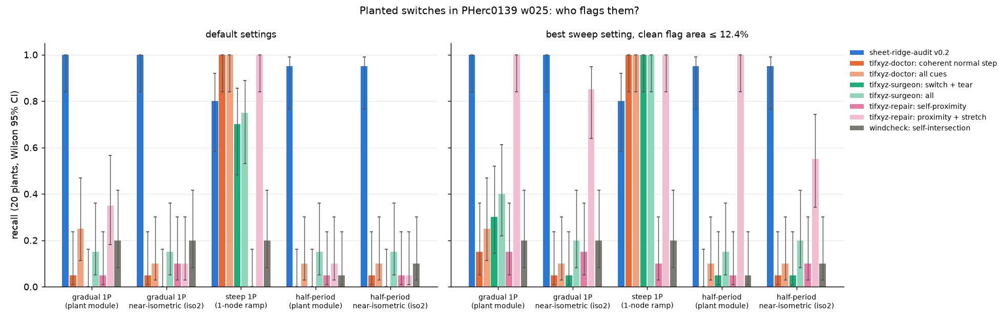

# sheet-ridge-audit v0.2 vs geometry-only checkers on planted sheet switches

> **Version: v0.2.** Every sheet-ridge-audit number in this file is **v0.2** (git `0b3578a`). v0.3 adopted two lessons from this study (the `geom_step` cue, after tifxyz-doctor and tifxyz-repair, and near-isometric plants); its re-run on the same 20 sites is in [`docs/RESULTS.md`](../../RESULTS.md) (v0.3 section) and is a **development** number (steep plants 16/20 -> 20/20).


Date: 2026-10-29 (runs 1:50-4:55 AM US Central). Host: 2 vCPU shared with
another agent (load 5-15), Lasagna `cos` streamed from the Vesuvius S3 bucket
on every sheet-ridge-audit run. Every number here comes from the runs below.
None is estimated. sheet-ridge-audit itself was not edited for this study.

## The short answer

* **At default settings, sheet-ridge-audit catches gradual switches and the
  geometry checkers do not.** On 20 gradual one-period plants it found 20/20
  (Wilson 95% CI 0.84-1.00). No geometry tool's default sheet-jump cue found
  more than 7/20. On the near-isometric version of the same plants (iso2, see
  below) none found more than 4/20. Half-period plants: sheet-ridge-audit
  19/20; the geometry tools 0-3/20.
* **The cost is far more flags on the clean segment:** 12.4% of the clean
  surface, against 0.00-0.83% for the geometry tools. This area is unlabelled,
  so 12.4% is an upper bound on false flags, not a measured false-positive rate.
* **On abrupt jumps the geometry checkers beat it, plainly.** On steep
  one-period plants (a 1-node ramp), tifxyz-doctor's coherent-normal-step cue
  and tifxyz-repair's stretch cells each found 20/20 at their defaults, at
  0.00-0.03% clean flag area. sheet-ridge-audit found 16/20 (0.58-0.92), and
  none of those 16 was flagged as a winding change: its own
  `score_plants` kind recall is 0/20. This is the limitation its README
  already states.
* **A lenient stretch threshold gives most of sheet-ridge-audit's advantage
  back on these plants.** tifxyz-repair's edge-stretch cue is hard-coded at
  1.5x the grid spacing; lowered to 1.1x it finds 20/20 of the raw gradual
  plants at 0.17% clean area. The reason is that the repo's plant module moves
  a fixed grid along the normals, which stretches edges (median per-plant
  maximum 1.36x, against a clean p99.9 of 1.09x). I made near-isometric
  versions of the plants (iso2: max edge ratio median 1.03x). On those, the
  best stretch setting within the same clean-area budget, 1.02x, still found
  17/20 (0.64-0.95), but only by flagging 8.6% of the clean surface.
  sheet-ridge-audit found 20/20 at 6.4%. That gap is within the confidence
  intervals.
* So the planted benchmark shows a **clear advantage over the tools' own
  sheet-switch cues and over their defaults**. It does **not** show a
  significant advantage over a geometry stretch cue tuned on the plants,
  because even the iso2 plants keep some metric distortion. A real tracer that
  wanders onto the next sheet grows an isometric grid, and so would leave
  less of it. That is an argument about real switches, not a measurement:
  recall on real, labelled switches is still unmeasured.



## Tools (pinned)

| tool | repo @ commit | license | how it was run | its sheet-jump cue |
|---|---|---|---|---|
| sheet-ridge-audit v0.2 | this repo @ `0b3578a` | MIT | `audit(seg, open_field("lasagna","PHerc0139"), stride=1)`, defaults | winding offset / off-ridge suspects |
| tifxyz-doctor 0.2.0 | aviad12g/tifxyz-doctor @ `5ca0444fb31863c8e02466316bf9e560cf567876` | MIT | `audit_mesh(load_tifxyz(p), AuditConfig(...))`, `_arrays` cell masks | `coherent_normal_step_cells` (v0.2 cue); also `review_cue_mask` (all cues) |
| tifxyz-surgeon 0.1.0 | enisme/tifxyz-surgeon @ `243fb9b25f46fa84768256346ef5ec3a84305f48` | MIT | `detect.analyse(load(p))` (the `check` command's code path) | `sheet_switch` + `grid_tear` boxes; also all detectors |
| tifxyz-repair 0.2.1 | Nieuwlaar/tifxyz-repair @ `4d6c98d95b71aa94dfed9398fbfe592419e62763` | MIT | `deep.inspect_patch(p, collect_cells=True)` (the `inspect --export-pointset` path) | `self_proximity` cells ("sheet-switch/merger suspects"); also + `stretch` cells |
| windcheck 0.1.0 | joe-carr-data/windcheck @ `2b0fb2f3d305d3727dcb24a8eaa73c3c8ce5c3ce` | MIT | `pipeline.census` (both diagonals, the authoritative census of `windcheck check`), engine `engines/selfcross.cpp` built with `g++ -O3` | quads in transverse self-intersections |
| vc_tifxyz_selfcross | ScrollPrize/villa `volume-cartographer/apps/src/vc_tifxyz_selfcross.cpp` (last change `d9d70bef`, main @ `7154682e`) | see villa | **skipped**: it needs a VC3D build | windcheck reports 274/274 agreement with it, so windcheck stands in |

All four Python tools installed cheaply into a separate venv (numpy, scipy,
tifffile, imagecodecs, zarr 2, s3fs; no torch, no CUDA). Each tool was called
through its own library entry point. Nothing was re-implemented, with one
exception: in the tifxyz-repair stretch-threshold sweep, deep.py's single line
`du > 1.5 * expected` was recomputed with other factors.

## Plants

Segment: PHerc0139 `20250108000000-on-20260102150214-2.399um.tifxyz` (w025,
native on the Lasagna scan; 1416 x 1324 grid, 1,552,672 valid vertices, 20 vx
spacing). Script: `scripts/make_plants.py`, seed 0.

* 40 sites from `plant.choose_sites` (plateau 8, ramp 10). The site choice
  avoids **no tool's flags**: the repo's own calibration avoided
  sheet-ridge-audit suspects, but that would bias the test toward places where
  it is clean. The first 20 sites are plants and the last 20 are sham sites.
  Signs are random (14 positive, 6 negative). The local period was measured
  per site from Lasagna: 53-119 vx, median 79.
* **gradual_1p**: shift +-1 local period, plateau radius 8 nodes, cosine ramp
  10 nodes (200 vx, 1.7-3.8 local periods).
* **steep_1p**: the same shift, ramp 1 node (one 20 vx grid step).
* **half_p**: shift +-0.5 period, ramp 10 nodes.
* **iso2 variants** of gradual_1p and half_p (`scripts/make_iso2_plants.py`):
  the same plants, displaced along normals smoothed with a Gaussian of sigma 3
  nodes. Then, inside 40 nodes of each centre, a 2-D grid warp is fitted
  (L-BFGS) so that edge lengths match the clean mesh, with every vertex kept on
  the displaced surface. Before the warp, the maximum edge-length ratio to the
  clean mesh per plant had a median of 1.36x (gradual) and 1.18x (half). After
  it: median 1.032x, max 1.133x (gradual); median 1.012x, max 1.054x (half).
  The normal offset at the plant centre stayed 0.99-1.06 of the planned shift.
  An earlier radial-only version (`*_iso`, `scripts/make_iso_plants.py`)
  reached only a median of 1.11x. It is kept in the full CSV.

## Detection rule (fixed before any tool was run, identical for all tools)

1. Each tool's output becomes a boolean node mask on the original tifxyz grid.
   A quad flag marks its 4 corner nodes; a box marks every node inside it.
2. **New flags** = flagged on the planted copy AND NOT flagged on the clean
   segment, for the same tool and setting. A flag that already existed never
   counts as a detection.
3. The planted region of a plant is its nodes with plant weight > 0.05,
   dilated by 2 nodes (4-connected).
4. A plant is **detected** if at least 3 new-flag nodes fall inside its region.
5. **Sham control**: the same rule is applied at the 20 sham sites (19 for
   iso2, keeping only those outside every warped disk). Across all 68 settings
   and 7 plant files the maximum was 1 sham hit, so detections are not
   spill-over.
6. **Clean flag area** = flagged valid nodes / valid nodes on the unmodified
   segment.
7. Confidence intervals are Wilson, 95%, n = 20.
8. **"Best" setting**: for each tool and plant type, the sweep setting with the
   highest recall among settings whose clean flag area is at most
   sheet-ridge-audit's default area (12.42%). Ties go to the lower area. This
   is tuned on the test plants (an oracle choice) for every tool, including
   sheet-ridge-audit.

sheet-ridge-audit's planted runs reuse the period measured on the clean run
(71.5 vx), as the repo's `calibrate_plants.py` does.

### Sweeps

| tool | default | sweep |
|---|---|---|
| sheet-ridge-audit | c0_thr 0, min_area 2 P^2 | c0_thr {-0.3, -0.15, 0, 0.15} x min_area {1, 2, 4} (min_quality 0.2; the repo found it has no effect) |
| tifxyz-doctor | normal_step_ratio 0.25, min component 8 | ratio {0.1, 0.15, 0.4} at 8 cells; min component {4, 16} at 0.25 |
| tifxyz-surgeon | analyse() (switch 4 cells, tear 2.5x, 40-report cap per detector) | switch_cells {1, 2, 3, 4} x tear_ratio {1.5, 2, 2.5}, report cap lifted |
| tifxyz-repair | proximity_factor 0.5, stretch 1.5x | proximity {0.25, 1.0}; stretch {1.01, 1.02, 1.03, 1.05, 1.075, 1.1, 1.25, 2.0} |
| windcheck | maxedge 60 | maxedge {120, 1e6} |

## Results

### Defaults

| tool | clean flag area | gradual 1P | gradual 1P iso2 | steep 1P | half-P | half-P iso2 |
|---|---|---|---|---|---|---|
| sheet-ridge-audit v0.2 | 12.42% | 20/20 (0.84-1.00) | 20/20 (0.84-1.00) | 16/20 (0.58-0.92) | 19/20 (0.76-0.99) | 19/20 (0.76-0.99) |
| tifxyz-surgeon sheet_switch+grid_tear | 0.02% | 0/20 (0.00-0.16) | 0/20 (0.00-0.16) | 14/20 (0.48-0.85) | 0/20 (0.00-0.16) | 0/20 (0.00-0.16) |
| tifxyz-surgeon all detectors | 0.83% | 3/20 (0.05-0.36) | 3/20 (0.05-0.36) | 15/20 (0.53-0.89) | 3/20 (0.05-0.36) | 3/20 (0.05-0.36) |
| tifxyz-repair self_proximity | 0.00% | 1/20 (0.01-0.24) | 2/20 (0.03-0.30) | 0/20 (0.00-0.16) | 1/20 (0.01-0.24) | 1/20 (0.01-0.24) |
| tifxyz-repair self_proximity+stretch | 0.03% | 7/20 (0.18-0.57) | 2/20 (0.03-0.30) | 20/20 (0.84-1.00) | 2/20 (0.03-0.30) | 1/20 (0.01-0.24) |
| windcheck self-intersection | 0.01% | 4/20 (0.08-0.42) | 4/20 (0.08-0.42) | 4/20 (0.08-0.42) | 1/20 (0.01-0.24) | 2/20 (0.03-0.30) |
| tifxyz-doctor coherent-normal-step | 0.00% | 1/20 (0.01-0.24) | 1/20 (0.01-0.24) | 20/20 (0.84-1.00) | 0/20 (0.00-0.16) | 1/20 (0.01-0.24) |
| tifxyz-doctor all cues | 0.07% | 5/20 (0.11-0.47) | 2/20 (0.03-0.30) | 20/20 (0.84-1.00) | 2/20 (0.03-0.30) | 2/20 (0.03-0.30) |

### Best sweep setting per plant type (clean flag area <= 12.42%)

| tool | gradual 1P | gradual 1P iso2 | steep 1P | half-P | half-P iso2 |
|---|---|---|---|---|---|
| sheet-ridge-audit v0.2 | 20/20 (0.84-1.00) @ c0=-0.3,min_area=4.0 [6.37%] | 20/20 (0.84-1.00) @ c0=-0.3,min_area=4.0 [6.37%] | 16/20 (0.58-0.92) @ c0=0.0,min_area=4.0 [12.06%] | 19/20 (0.76-0.99) @ c0=-0.15,min_area=4.0 [8.78%] | 19/20 (0.76-0.99) @ c0=-0.15,min_area=4.0 [8.78%] |
| tifxyz-doctor coherent-normal-step | 3/20 (0.05-0.36) @ ratio=0.1,min_cells=8 [0.07%] | 1/20 (0.01-0.24) @ ratio=0.4,min_cells=8 [0.00%] | 20/20 (0.84-1.00) @ ratio=0.4,min_cells=8 [0.00%] | 0/20 (0.00-0.16) @ ratio=0.4,min_cells=8 [0.00%] | 1/20 (0.01-0.24) @ ratio=0.4,min_cells=8 [0.00%] |
| tifxyz-doctor all cues | 5/20 (0.11-0.47) @ ratio=0.25,min_cells=4 [0.07%] | 2/20 (0.03-0.30) @ ratio=0.25,min_cells=4 [0.07%] | 20/20 (0.84-1.00) @ ratio=0.25,min_cells=4 [0.07%] | 2/20 (0.03-0.30) @ ratio=0.25,min_cells=4 [0.07%] | 2/20 (0.03-0.30) @ ratio=0.25,min_cells=4 [0.07%] |
| tifxyz-surgeon sheet_switch+grid_tear | 6/20 (0.14-0.52) @ switch_cells=1.0,tear_ratio=1.5 [0.04%] | 1/20 (0.01-0.24) @ switch_cells=1.0,tear_ratio=2.5 [0.02%] | 20/20 (0.84-1.00) @ switch_cells=2.0,tear_ratio=2.5 [0.02%] | 1/20 (0.01-0.24) @ switch_cells=1.0,tear_ratio=1.5 [0.04%] | 1/20 (0.01-0.24) @ switch_cells=2.0,tear_ratio=2.5 [0.02%] |
| tifxyz-surgeon all detectors | 8/20 (0.22-0.61) @ switch_cells=1.0,tear_ratio=1.5 [0.85%] | 4/20 (0.08-0.42) @ switch_cells=1.0,tear_ratio=2.5 [0.83%] | 20/20 (0.84-1.00) @ switch_cells=2.0,tear_ratio=2.5 [0.83%] | 3/20 (0.05-0.36) @ default [0.83%] | 4/20 (0.08-0.42) @ switch_cells=2.0,tear_ratio=2.5 [0.83%] |
| tifxyz-repair self_proximity | 3/20 (0.05-0.36) @ proximity_factor=1.0 [0.01%] | 3/20 (0.05-0.36) @ proximity_factor=1.0 [0.01%] | 2/20 (0.03-0.30) @ proximity_factor=1.0 [0.01%] | 1/20 (0.01-0.24) @ default [0.00%] | 2/20 (0.03-0.30) @ proximity_factor=1.0 [0.01%] |
| tifxyz-repair self_proximity+stretch | 20/20 (0.84-1.00) @ stretch_factor=1.1 [0.17%] | 17/20 (0.64-0.95) @ stretch_factor=1.02 [8.56%] | 20/20 (0.84-1.00) @ stretch_factor=2.0 [0.02%] | 20/20 (0.84-1.00) @ stretch_factor=1.03 [3.02%] | 11/20 (0.34-0.74) @ stretch_factor=1.02 [8.56%] |
| windcheck self-intersection | 4/20 (0.08-0.42) @ default [0.01%] | 4/20 (0.08-0.42) @ default [0.01%] | 4/20 (0.08-0.42) @ default [0.01%] | 1/20 (0.01-0.24) @ default [0.01%] | 2/20 (0.03-0.30) @ default [0.01%] |


Full sweep: `out/baseline_all_settings.csv` (68 settings, with per-plant hit
strings and sham counts). Defaults and best settings:
`out/baseline_table.csv`. Raw per-run logs and timings are not shipped.

### What the numbers say

* **Gradual one-period switches.** With its defaults, sheet-ridge-audit is the
  only tool that finds them: 20/20 on both plant sets. Its winding sign was
  right on 19/20 (`score_plants` kind recall 0.95). Each geometry tool's
  documented switch cue stays at 0-6/20 even after its best sweep setting:
  doctor coherent-normal-step, surgeon switch+tear, repair self-proximity.
  This matches what those tools document about themselves: doctor "does not
  claim natural sheet-switch recall", and surgeon says a feathered
  displacement is caught by nothing.
* **The exception is edge stretch.** tifxyz-repair's stretch cells were never
  presented as a switch detector, but with a lowered threshold they catch the
  plants' metric distortion. Raw plants: 20/20 at 1.1x (0.17% clean area).
  iso2 plants: 17/20 at 1.02x (8.6%), 14/20 at 1.03x (3.0%), 9/20 at 1.05x
  (0.74%). sheet-ridge-audit's tightest setting tested (c0 -0.3, min_area 4)
  keeps 20/20 at 6.4%. On iso2, then, sheet-ridge-audit's lead over a tuned
  stretch cue is 20/20 vs 17/20 at comparable clean area. The intervals
  overlap. On iso2 half-period plants the lead is larger: 19/20 vs 11/20.
* **Steep one-period jumps: the geometry checkers win.** doctor's
  coherent-normal-step and repair's stretch cells find 20/20 at defaults with
  about 0% clean area. Surgeon finds 14/20 at defaults; 6 were dropped by its
  40-report cap, and with the cap lifted it finds 20/20. sheet-ridge-audit
  finds 16/20, all as `off_ridge` only, with 0/20 correct winding. Its 4
  misses are at sites whose local period is 66-119 vx.
* **windcheck** detects only self-intersections. It flagged the same 3-4
  sites in every one-period file, likely where the shifted plateau crosses
  another wrap of w025 itself. That is a real consequence of a switch, but
  only for some of them.

## Caveats

* **These are synthetic plants in one real segment, not labelled real
  switches.** Recall on real switches and the precision of real flags are not
  measured, for any tool.
* **Plant realism decides the stretch result.** The repo's plant module, which
  sheet-ridge-audit's own calibration uses, leaves a large stretch fingerprint
  that any metric check can see. iso2 removes most of it but not all (the
  median max edge ratio is 1.03x, at clean p99). How much stretch a real
  traced switch has is unknown.
* **sheet-ridge-audit's 12.4% clean flag area is an upper bound, not an FP
  rate.** Some of those flags may be real errors. The geometry tools' flag
  areas are 15-100x smaller.
* **The "best" settings are tuned on the test plants for every tool.** They
  are an optimistic ceiling, not a deployable setting.
* n = 20 per type, so the CIs are wide: 20/20 has a lower bound of 0.84.
* All plant types share the same 20 sites, so per-site comparisons across
  tools and types are paired.
* **Run times on the loaded host.** sheet-ridge-audit at stride 1: 163-440 s
  per run (it streams Lasagna each time). Per file: doctor 60-100 s per
  setting, surgeon 12-23 s, repair 3-10 s, windcheck 16-24 s per maxedge.

## Files

* `scripts/make_plants.py`: plants and sites (needs the Lasagna field for the
  periods).
* `scripts/make_iso_plants.py`, `scripts/make_iso2_plants.py`: near-isometric
  variants.
* `scripts/run_sra.py`: sheet-ridge-audit masks, default and sweep.
* `scripts/run_baselines.py`: geometry tools (run in the geometry tools' venv).
* `scripts/add_stretch_sweep.py`: the extra tifxyz-repair stretch factors.
* `scripts/score.py`: the rule above → CSVs. `scripts/figure.py` →
  `out/comparison.png`.
* `scripts/_stretch.py`: stretch statistics for the raw plants.
* `work/masks/*.npz`: per-node flag masks (packbits), all tools and settings.
  `work/plants/*/`: plants.json and weight maps. (Both are regenerated under `$SRA_EVAL_DATA/baseline/work`; not shipped.)
* The planted tifxyz copies were deleted after scoring. They can be regenerated
  deterministically with the scripts.
* `tools/`: the four cloned repos at the commits above (not shipped; clone them at the pinned commits).

Shipped here: `out/baseline_table.csv`, `out/baseline_all_settings.csv`, `out/baseline_summary.json`, `out/sites.json`, `out/iso_stats.json`, `out/iso2_stats.json`, `out/score_stdout.txt`, `out/comparison.png`. Scripts are in `scripts/eval/baseline/` (`scripts/` above). To reproduce (work files under `$SRA_EVAL_DATA/baseline`, default `./sra-eval-data/baseline`; the w025 segment, 22 MB, is downloaded on first use):

```bash
export SRA_EVAL_DATA=$PWD/sra-eval-data
pip install 'git+https://github.com/landonking0808/sheet-ridge-audit@0b3578a'   # v0.2, the version measured here
python scripts/eval/baseline/make_plants.py            # 40 sites, plants (seed 0)
python scripts/eval/baseline/make_iso_plants.py; python scripts/eval/baseline/make_iso2_plants.py
python scripts/eval/baseline/run_sra.py clean gradual_1p steep_1p half_p gradual_1p_iso2 half_p_iso2   # streams Lasagna; 3-7 min each
# geometry tools: in a venv with tifxyz-doctor, tifxyz-surgeon, tifxyz-repair, windcheck installed from the commits above
python scripts/eval/baseline/run_baselines.py clean gradual_1p steep_1p half_p gradual_1p_iso2 half_p_iso2
python scripts/eval/baseline/add_stretch_sweep.py
python scripts/eval/baseline/score.py && python scripts/eval/baseline/figure.py
```
