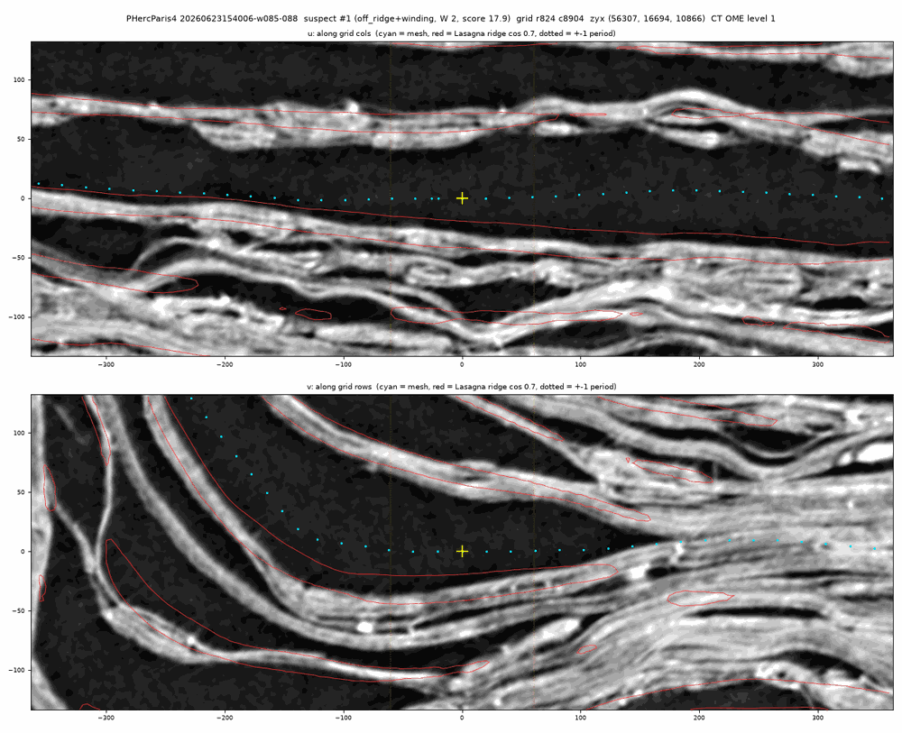
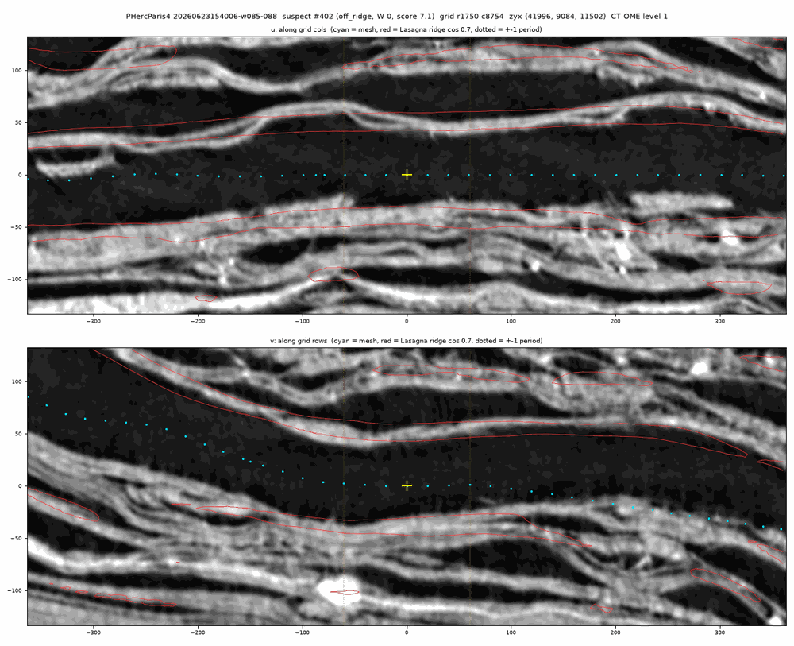

# Held-out test: v0.3 on PHercParis4 (Scroll 1)

Run 2026-10-29, about 1:30-2:30 AM US Central, on a shared 2-vCPU host
(11 GB RAM, load average 4-27 from other jobs).

**Tested code: git `7ee738e`** (`7ee738e570be147e76fcd964238dcdf396fd2cbd`,
"v0.3: winding seams instead of plateau tiles ..."). Its `src/` tree was
exported with `git archive` and every script imported it from that frozen
copy, so edits made to the repo during the run could not leak in.
`git diff 7ee738e v0.3.0 -- src` is empty: **the tested code is identical to
the released v0.3.0.** Default `Params()`; Lasagna backend
`open_field("lasagna", "PHercParis4")` (model 20260419180421-L2, scan
20260411134726, 2.4 um); `stride=2`, `upsample="auto"`.

PHercParis4 was not used at any point while v0.2 or v0.3 were built or tuned
(all development used PHerc0139).

> **The labels are one AI agent's (Claude's) visual review of 2-D CT
> cross-sections. They are not expert annotation and were not checked in
> VC3D.** The same kind of reviewer made the PHerc0139 development labels.
> Read every precision number below as a rough estimate.

## Selection (seeded, fixed before any result)

`select_segments.py`. Pool: 71 catalog segments of PHercParis4 traced natively
on the Lasagna scan (`original_volume_id` 20260411134726), 70 of them with a
`mesh/<id>-on-20260411134726-2.4um.tifxyz`. Rule fixed in advance: drop the 3
whose catalog `tiff_dimensions` exceed 3.0 M cells, sort by id, shuffle with
`random.Random(20261029)`, and take segments in that order, skipping one whose
wrap range (e.g. `w053-058`, `_jordi`/`_copy` stripped) was already taken,
until 10:

`5753_-1`, `5753_0`, `w053-058_jordi`, `w064-068`, `w073-076`, `w085-088`,
`w098-100`, `w118-119`, `w120-121`, `w122-123` (`selection.json`).

**Deviation: windows on the huge banner segments.** The catalog's
`tiff_dimensions` turned out not to be the grid size. The real grids have
2.1-32.8 M valid vertices; the 8 "banner" traces (w0xx/w1xx, June/July 2026)
are 15-33 M, 10-20x a PHerc0139 segment. The first attempt ran two at full
size and the host ran out of memory; only `5753_-1` had finished. A rule was
then fixed (`roi_rule.json`, in `census.py`), **before any suspect or review
result of the other segments was seen**: a segment with more than 3.0 M valid
vertices is audited on one 1600 x 1600-node window of its original grid
(2.56 M cells, the size of a PHerc0139 segment), its corner drawn with
`random.Random(20261029 + index in selection.json)` among positions on a
100-node lattice where the window is at least 80% valid. So **8 of the 10
segments were audited on a random window covering 8-17% of the segment**; the
two `5753_*` segments were audited whole. Those two are separate catalog
segments but cover the same part of the scroll, so they are not independent.

## Census

`census.py` -> [`census.csv`](census.csv) (one row per segment or window).

* Flagged area: **median 0.346** (range 0.154-0.468). The two `5753_*`
  segments (0.15-0.17) and `w122-123` (0.19) look like PHerc0139; the other 7
  banner windows are at 0.33-0.47. On PHerc0139, v0.3 flagged a median 0.206
  (21 segments, development data).
* On-ridge fraction: median 0.674 (0.600-0.864), against 0.83 in the v0.2 PHerc0139 census.
  The census cannot tell whether the Scroll 1 traces leave the ridge more often
  or Lasagna fits Scroll 1 worse.
* 24.6 M vertices audited, 13.3 M sampled, 31,536 suspects (14,443 contain
  `winding`, 147 `geom_step`, 17,004 `off_ridge` only).
* Runtime per segment or window, download to written outputs: median 128 s
  (84-239 s) on the loaded host.

## Blind review: design

`review_render.py select` -> `review/items.json` (the key), seed 20261029,
fixed before any image was drawn.

* **40 suspects**: the top 2 of each segment (20; all are `winding` seams, 14
  also `geom_step`), and 20 mid-ranked items drawn from rank 3 to each
  segment's median rank, stratified by kind (7 `winding`, 7 `off_ridge` only,
  6 `geom_step` without winding; ranks 115-2,625).
* **20 controls**: 2 per segment, random unflagged sampled vertices inside the
  mesh, at least 2 periods from any suspect.
* **Images**: two CT slices through the vertex (along grid u and grid v,
  orthogonal to the mesh) at OME level 1, +-6 periods along the surface and
  +-2.2 periods along the normal; mesh in cyan, Lasagna cos = 0.7 in red. The
  60 images were shuffled and named H01-H60 with no score, kind, rank or
  segment shown, labelled in id order, and the labels were frozen
  (`review/labels_blind.csv`, sha256 in `review/labels_blind.sha256`) before
  the key was read. One leak: the reviewer knew a third of the images were
  controls, not which.
* **Labels**: REAL = the mesh visibly leaves its sheet (runs through a dark
  gap or crosses onto another sheet); PLAUSIBLE = ambiguous (touching or
  merged layers, junctions, crushed material, riding just off a sheet face,
  the scan's mask edge); FALSE = on one sheet; UNREADABLE (1 item, both
  slices in the scan's zero-masked region) is left out of the denominators.
  Every label has a reason in [`review.csv`](review.csv).

## Results

Wilson 95% intervals; `analyze.py` -> [`review/analysis.txt`](review/analysis.txt).

| subset | n | precision, REAL | precision, REAL + PLAUSIBLE |
|---|---|---|---|
| **all reviewed suspects** | 39 (+1 unreadable) | **18/39 = 0.46 [0.32, 0.61]** | **31/39 = 0.79 [0.64, 0.89]** |
| the same, unreadable counted FALSE | 40 | 18/40 = 0.45 [0.31, 0.60] | 31/40 = 0.78 [0.62, 0.88] |
| **top 2 per segment** | 19 (+1) | **13/19 = 0.68 [0.46, 0.85]** | **19/19 = 1.00 [0.83, 1.00]** |
| rank 1 | 9 (+1) | 7/9 = 0.78 [0.45, 0.94] | 9/9 = 1.00 [0.70, 1.00] |
| rank 2 | 10 | 6/10 = 0.60 [0.31, 0.83] | 10/10 = 1.00 [0.72, 1.00] |
| **mid-ranked** (rank 3 to median, kind-stratified) | 20 | **5/20 = 0.25 [0.11, 0.47]** | 12/20 = 0.60 [0.39, 0.78] |
| mid-ranked `winding` seams | 7 | 1/7 = 0.14 [0.03, 0.51] | 2/7 = 0.29 [0.08, 0.64] |
| mid-ranked `off_ridge` only | 7 | 1/7 = 0.14 [0.03, 0.51] | 4/7 = 0.57 [0.25, 0.84] |
| mid-ranked `geom_step` without winding | 6 | 3/6 = 0.50 [0.19, 0.81] | 6/6 = 1.00 [0.61, 1.00] |

**Controls (misses).** Of 20 unflagged control vertices, 4 were labelled REAL
(4/20 = 0.20 [0.08, 0.42]; REAL + PLAUSIBLE 10/20). Mapping each departure
back onto the grid, one lies inside a v0.3 suspect 3 periods from the control
vertex; the other three are covered by no suspect: **3-4 of 20 controls are
missed defects** (strict 3/20 = 0.15 [0.05, 0.36]). At those spots Lasagna's
cos at the mesh is 0.43-0.85: the field itself puts a ridge where the mesh
crosses a gap, and the tool inherits that error. On PHerc0139 it was 0/21.

**Separation** (Fisher exact): top 2 vs mid-ranked, REAL 13/19 vs 5/20,
p = 0.010; suspects vs controls, REAL 18/39 vs 4/20, p = 0.09, and REAL +
PLAUSIBLE 31/39 vs 10/20, p = 0.035.

### Compared with the PHerc0139 development numbers

| measure | PHerc0139, v0.3 dev ([`../../RESULTS.md`](../../RESULTS.md)) | PHercParis4, held out |
|---|---|---|
| items | 31 v0.2 flags still flagged by v0.3 | 40 of v0.3's own flags |
| precision, REAL | 13/31 = 0.42 [0.26, 0.59] | 18/39 = 0.46 [0.32, 0.61] |
| precision, REAL + PLAUSIBLE | 24/31 = 0.77 [0.60, 0.89] | 31/39 = 0.79 [0.64, 0.89] |
| ranking separates REAL from FALSE | no evidence | top 2 vs mid: 0.68 vs 0.25 REAL, p = 0.01 |
| unflagged controls REAL | 0/21 | 4/20 (strict 3/20) |
| flagged area per segment, median | 0.206 | 0.346 |

What this does and does not show:

* **Overall precision carried over to unseen data**, within the development
  intervals. The two samples were drawn differently, so this is a consistency
  check, not a replication.
* **The clear defects are at the top of each segment's list.** 13 of 19
  readable top-2 suspects are clear departures and all 19 are at least
  PLAUSIBLE. Below the top, precision falls to 0.25 REAL. Read the top of each
  list, not the whole list.
* **Misses are not negligible on Scroll 1** (3-4 of 20 controls), and the tool
  flags much more of the surface (35% vs 21%), mostly in the 2026 banner traces.
* **The intervals are wide** (about +-0.15 overall, wider per stratum); kind
  comparisons rest on 6-13 items, and kind and rank are confounded (all top-2
  items are seams).

## Caveats

* **Labels**: one AI reviewer, two 2-D slices per item, not experts, not
  checked in VC3D. The reviewer had seen the PHerc0139 review and knew 20 of
  60 images were controls. A departure anywhere in the +-6-period view counts,
  so a REAL label means "a visible departure near the vertex", not "the flagged
  band is exactly a switch".
* **Sampling**: 8 of 10 segments were audited on one random window (8-17% of
  the segment) under a rule fixed after the out-of-memory failure; the size
  filter used catalog dimensions that were not the grid size; the two `5753_*`
  segments overlap in the scroll. The numbers describe the reviewed strata
  (top 2, kind-stratified mid, controls), not all 31,536 suspects.
* `phase_cut` no longer exists in v0.3, so it was not sampled.

## Figures (clear REAL examples, chosen after unblinding)

Same layout as the review images: top panel along grid u, bottom along grid v;
cyan = mesh, red = Lasagna ridge (cos 0.7). Grid row/col in the original
tifxyz grid; zyx in level-0 voxels.



[`fig1`](figures/fig1_w085-088_s1_mesh_leaves_band_into_gap.png):
`20260623154006-w085-088` suspect **#1** (off_ridge+winding, W +2, score 17.9),
r824 c8904, zyx (56307, 16694, 10866). In u, the mesh leaves the top of the
lower band near -100 and runs level through the dark gap while the band
descends; in v, it comes down through the gap and crosses it to join a band
right of +150.



[`fig2`](figures/fig2_w085-088_s402_mesh_mid_gap.png):
`20260623154006-w085-088` suspect #402 (off_ridge only, score 7.1, mid-ranked),
r1750 c8754, zyx (41996, 9084, 11502). In u, the mesh runs through the middle
of a wide dark gap for the full 700 voxels; in v, it crosses the gap
diagonally from the upper band to the lower one.

## Files

* `TESTED_COMMIT`: the tested commit.
* `catalog_pool_all.json` (the PHercParis4 catalog pool), `selection.json`,
  `roi_rule.json`: the selection and the window rule.
* `census.csv`: one row per segment or window (grid, audited window `roi` and
  its share `roi_frac`, sampled vertices, period, on-ridge and seam fractions,
  suspect counts by kind, flagged area, timings, segment URL).
* `review.csv`: 60 rows (40 suspects, 20 controls): `blind`, `stratum`,
  `kclass`, `seg`, `rank`, `kinds`, `score`, `W`, `grid_row`, `grid_col`, mesh
  `z`/`y`/`x`, `label`, `reason`, `segment_url`.
* `review/labels_blind.csv` (+ `.sha256`): the labels as frozen before
  unblinding. `review/items.json`: the key. `review/analysis.txt`: the full
  tables (also by kind and winding offset).
* `figures/`: the two figures above.
* Not shipped: the 60 review images, the per-segment run folders (~124 MB)
  and the segments; the scripts regenerate them.

## Reproducing

Scripts in [`scripts/eval/heldout/`](../../../scripts/eval/heldout/); outputs
go under `$SRA_EVAL_DATA/heldout` (default `./sra-eval-data/heldout`), shipped
inputs are read from this folder.

```bash
pip install 'git+https://github.com/landonking0808/sheet-ridge-audit@7ee738e'   # the tested code (src identical to v0.3.0)
export SRA_EVAL_DATA=$PWD/sra-eval-data
# optional, as in the test: import a frozen src/ tree instead of the installed package
#   git archive 7ee738e src | tar -x -C /path/frozen && export SRA_SRC=/path/frozen/src

python scripts/eval/heldout/select_segments.py       # seeded selection -> selection.json (same 10 segments)
python scripts/eval/heldout/census.py                # audit (windows on >3 M-vertex segments) -> census.csv, runs/
                                                     #   ~13 min with 2 workers on 2 vCPU (REVERSE=1 for the 2nd)
python scripts/eval/heldout/review_render.py select  # 40 suspects + 20 controls -> review/items.json (the key)
python scripts/eval/heldout/review_render.py render  # blind CT cross-sections H01-H60 -> review/img/
python scripts/eval/heldout/analyze.py               # unblind + tables from the shipped labels -> review.csv, review/analysis.txt
python scripts/eval/heldout/make_figures.py          # the two figures (needs runs/ from census.py) -> figures/
```

`analyze.py` alone runs offline from the shipped files and reproduces
`review.csv` and `review/analysis.txt` byte for byte (needs `scipy`).
